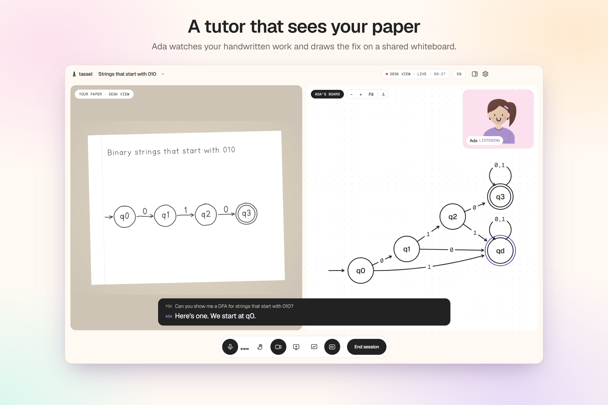
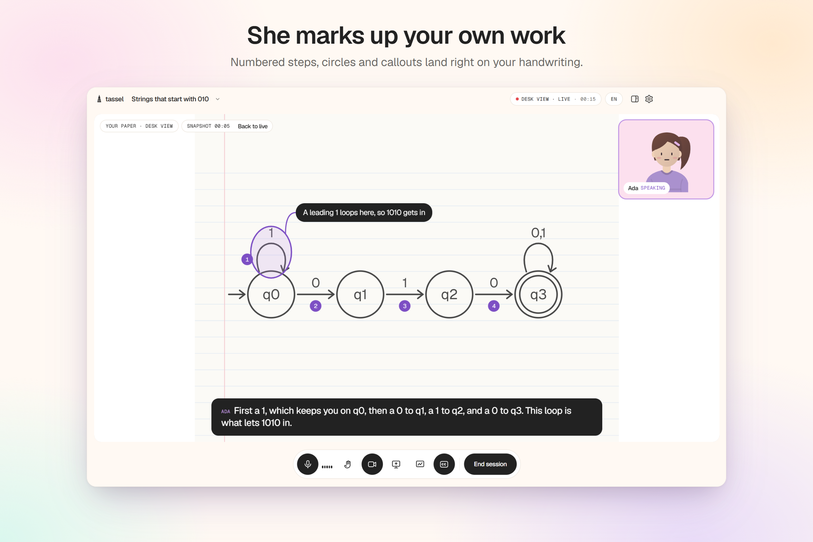
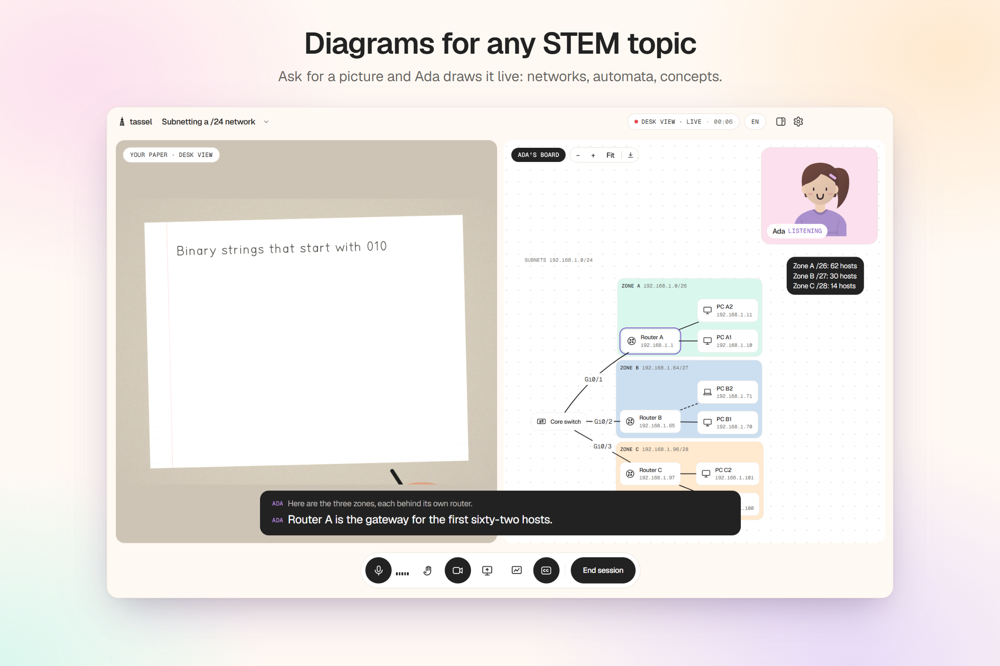
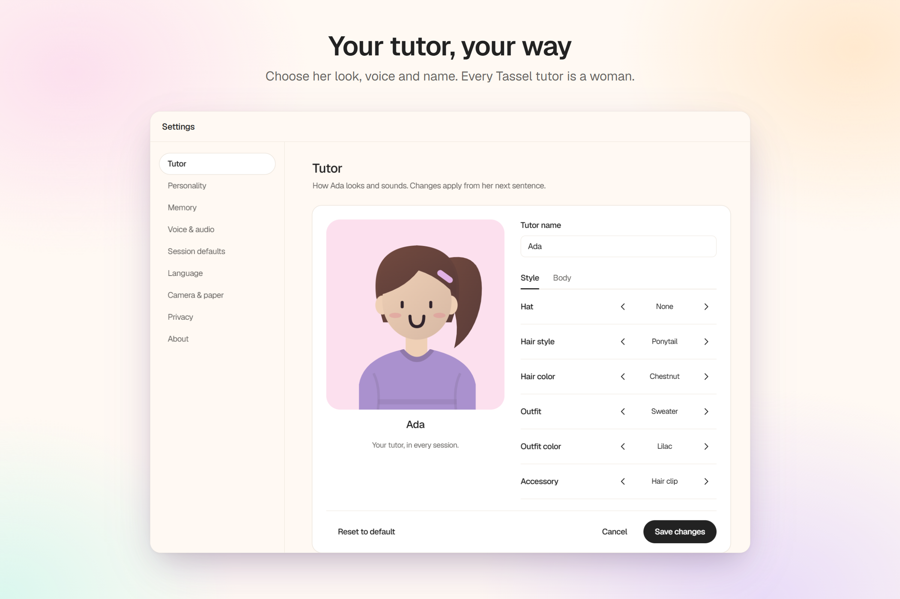
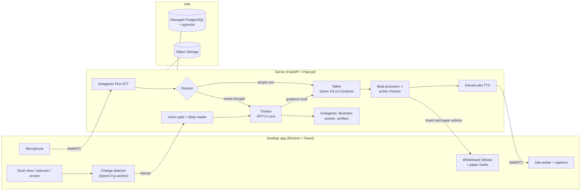

# Tassel

**A live AI tutor that sees your paper, talks it through with you and draws on your work.**

Tassel is a desktop study companion. Ada, your tutor, watches your worksheet through your Mac's Desk View camera (or your screen when you share it), talks with you in real time, and explains by drawing on a shared whiteboard and directly over your own handwriting. She works in English, Spanish and Korean.

[gettassel.study](https://gettassel.study)



## Why

Stanford researchers found that girls tutored by women showed [greater interest in STEM](https://nssa.stanford.edu/studies/impact-tutor-gender-match-girls-stem-interest-engagement-and-performance). Tassel makes that kind of mentorship available to anyone: a woman tutor you customize, in your own language, who works from what's actually on your desk. Our focus is women in STEM, including women returning to the field and re-certifying a degree across a language barrier.

## What it does

- **Sees your work.** Paper through macOS Desk View or a webcam, or your screen through a translucent overlay bar. A change detector sends a frame only when you pause writing.
- **Talks in real time.** Streaming speech in and out, with interruptions in both directions and live captions.
- **Draws on your work.** Ada circles, numbers and annotates your own handwriting, and draws automata, network diagrams and concept sketches on a shared tldraw whiteboard.
- **Teaches like a tutor.** Ada steps in at natural pauses. She asks you to find the mistake first, then shows your own work back with a failing input, and gives the answer only when you need it.
- **Checks with real algorithms.** DFA answers are verified by determinization and counterexample search, and networking diagrams by subnet checks. Ada doesn't guess.
- **Is yours.** Choose Ada's look, voice, name and personality. She keeps notes on how you learn, which you can read, edit or delete.
- **Speaks your language.** English, Spanish and Korean, from the menus to the voice.

| Marks on your paper | Diagrams on the board | Your tutor, your way |
|---|---|---|
|  |  |  |

## How it works



**A fast talker and a smart thinker.** A single model was either quick and shallow or smart and slow, so the tutor is a team of agents:

| Agent | Model | Job |
|---|---|---|
| Director | rules + small model | Picks each turn's view (paper, board, split), whether vision is needed, the action and the route. Its deterministic rules also serve as the fallback, so Ada never goes silent. |
| Talker | Qwen 3.8 27B on Cerebras (OpenRouter) | Speaks every turn, about 250–450 ms to first token. Says a natural bridge line while the thinker works. |
| Thinker | GPT-6 Luna | Background orchestrator. Returns a schema-validated guidance brief: what's on the page, the diagnosis, a teaching plan, the line to say, and the board drawings and paper marks to make. Thinks the next step ahead while Ada speaks. Board constructions use GPT-6 Astra. |
| Illustrator | Qwen on Cerebras or GPT-6 Luna | Turns a request into a validated diagram spec, with one automatic repair pass. |
| Pointer | GPT-6 Luna | Resolves "circle my subnet mask" to a region of the page, then snaps it onto the actual pencil strokes with an OpenCV ink mask. |
| Vision gate | GPT-6 Luna | Scores new frames (complete? worth checking? stuck?) at most every 5 s. |
| Deep reader | Claude Opus 5.5 | Transcribes handwriting into structured data with per-item confidence. Low-confidence reads are confirmed with the student. |
| Titler | Qwen (OpenRouter) | Names each session and tags its subject from the first real exchange. |

**Speech, drawing and animation stay in sync.** Agents put actions in their streamed text as tags (`[[circle m3]]`, `[[trace 0101]]`). A beat processor turns them into timed beats before the speech reaches text-to-speech, so a circle appears as Ada says "this state right here." An action checker dry-runs every command first, and the spoken line is rewritten so Ada never describes a drawing that didn't happen.

**Memory.** Each learner has one bounded, editable memory document, updated once at the end of a session, plus a personality description only the student writes. Both feed every agent's context.

## Tech stack

| Layer | What we used |
|---|---|
| Desktop | Electron 44, React, TypeScript, Tailwind v4, tldraw, OpenCV.js, a Swift Desk View helper |
| Server | Python 3.12, FastAPI, Pipecat (WebRTC), SQLAlchemy (async), Alembic, `automata-lib`, OpenCV |
| AI | OpenAI (GPT-6 Luna and Astra), OpenRouter (Qwen 3.8 on Cerebras), Anthropic (Claude Opus 5.5), Deepgram Flux, ElevenLabs |
| Data | PostgreSQL 17 with pgvector, S3-compatible object storage |
| Infrastructure | Vultr Managed PostgreSQL and Vultr Object Storage, with Docker for an identical backend on every machine |
| Website | Next.js (`apps/web`), at [gettassel.study](https://gettassel.study) |

## Getting started

You need macOS (the primary target) or Windows, with:

- **Node 22.18 or later**
- **pnpm 12** (`corepack enable` gives you the pinned 12.6.0)
- **Docker Desktop** (on Windows, the WSL 2 backend)
- **[uv](https://docs.astral.sh/uv/)**, for the server tests, `pnpm check` and `--host-server`

```sh
pnpm install
pnpm start
```

On Windows, `Start-Tassel.cmd` does the same as `pnpm start`. It starts the backend in Docker (Postgres, S3 and the server on http://127.0.0.1:8787, migrated), then opens the app. Choose Paper, Screen, voice, board and tutor settings inside the app; there's one launcher for everything. `pnpm start --check` prints a startup summary without opening anything. See [the startup contract](docs/startup.md) for profiles, worktrees and overrides.

**Provider keys** go in the file `TASSEL_VOICE_ENV_FILE` names (else `services/server/.env`). It's mounted read-only into the server container, never baked into the image. With no keys, the server runs fake providers and the app plays a scripted demo tutor, so you can try the whole interface offline.

**Paper without a Desk View camera:** `TASSEL_PAPER_SOURCE=fake-clip pnpm dev` plays a generated clip of a DFA being drawn.

## Commands

| Command | What it does |
|---|---|
| `pnpm start` | Shared startup: the current checkout, saved profile, Docker backend and the app |
| `pnpm dev` | The Docker backend, then the app with the fake tutor. `--host-server` runs the server with uv on the host |
| `pnpm live` | The owner's live run on macOS, with provider keys |
| `pnpm test` | Every package's unit tests (Vitest), then the server's tests (pytest) |
| `pnpm test:changed` | Only the tests your change needs. `--dry-run` shows the plan |
| `pnpm e2e` | Builds the app and runs the Playwright E2E specs on the fake camera |
| `pnpm check` | Biome, typechecks, the en/es/ko catalog check, the API client check and ruff |
| `pnpm gen:api` | Regenerates the typed API client after a server API change |

`pnpm test` and `pnpm e2e` need `docker compose up -d db s3` (or a running `pnpm dev`). [CLAUDE.md](CLAUDE.md) explains which tests to run when.

## Repository layout

| Path | What's there |
|---|---|
| `apps/desktop` | The Electron app: `src/main` (window, protocol, IPC, device token), `src/preload` (the `window.tassel` bridge), `src/renderer` (React: library, sessions, board, paper capture, voice, avatar, settings, the scripted demo tutor) |
| `apps/web` | The landing page (Next.js) |
| `services/server` | The FastAPI server: `voice/` (Pipecat bot, director, talker, thinker, illustrator, pointer, ladder), `vision/` (gate, deep reader, preprocessing), `domains/` (DFA and network verifiers), `beats/`, `board/`, `chat/`, `frames/`, storage and migrations |
| `packages/shared` | Design tokens and fonts, the en/es/ko catalogs, the beat format and the typed API client |
| `packages/paper-synth` | Synthetic paper clips for tests and the demo |
| `native/deskview-helper` | The Desk View helper (Swift, macOS) |
| `docs` | Product, design system, specs, plans, research and [development details](docs/development.md) |
| `scripts` | Startup, the Docker backend, the camera launcher, test selection and checks |

## Platforms

macOS is the primary target. Windows works too, but has no Desk View: Paper sessions use an ordinary webcam, and new sessions default to screen share. See [Windows setup](docs/windows-local-setup.md).

## More

- [PRODUCT.md](PRODUCT.md): who Tassel is for and the principles behind it
- [The design](docs/superpowers/specs/2026-10-17-tassel-design.md) and [the two-tier tutor](docs/superpowers/specs/2026-10-17-two-tier-tutor.md)
- [Development details](docs/development.md): paper capture, camera checklists and environment variables
