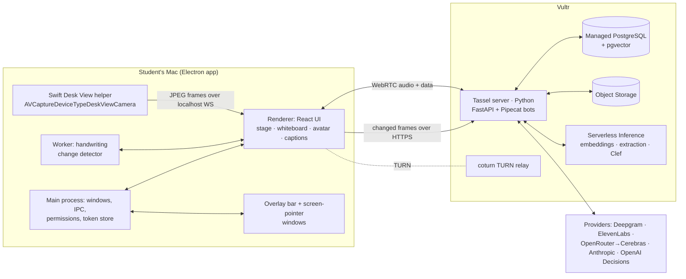

# Tassel: design

*Status: draft for review, 2026-10-17. Product truth is in `PRODUCT.md`. Source spec: `docs/source/ghh.md`. Research: `docs/research/00`–`04`. In this document "**(call)**" marks a decision Claude made that the product owner hasn't confirmed; everything else came from the spec, the owner's answers, or verified research.*

## 1. Intent

Tassel is a live AI tutor for the desktop. It sees the student's paper (macOS Desk View) or screen, talks with her in real time, interrupts like a good tutor would, and explains by drawing on a shared whiteboard and directly over her own work. It works in English, Spanish and Korean, through a woman tutor the student customizes.

The pitch is that this helps close the gender gap in STEM, especially for immigrant women re-entering STEM through a second language. The product shouldn't be narrowed to that story: it is a general tutor.

**What "done" means:** a polished app the team can demo live, and that genuinely works beyond the scripted path. The owner set no deadline: "work/focus on the app and polish it". Quality beats speed, and every feature is exercised in the running app, not just in unit tests.

Done covers **three subjects that each work well**, chosen by the owner:

- **Automata theory:** DFA, NFA, PDA and Turing machines.
- **Cell biology.**
- **Organic chemistry.**

Other subjects work on a best-effort basis (§5.8).

The demo is the north star for priorities (section 9). Nothing is faked on stage: the tutor in the demo is the real system.

## 2. Goals, non-goals, anti-goals

**Goals**

1. **Real-time voice tutoring**, where the student and tutor can each interrupt the other. Time to first tutor audio: ≤ 1.2 s in English and Spanish, ≤ 1.4 s in Korean. When the student barges in, the tutor falls silent within ~300 ms.
2. **Paper view.** The live Desk View feed. The tutor watches for handwriting changes, decides when to step in, and draws over the live paper in a split view beside the whiteboard.
3. **Whiteboard in every session.** The tutor draws while she explains. The student can draw too, and the tutor sees what she drew.
4. **Screen-share mode.** The app collapses to a translucent overlay bar. The tutor sees the screen, can point at things on it, and draws diagrams on request.
5. **A customizable 2D SVG tutor** with lip-sync, plus a female voice with per-language accent choices.
6. **A session library** with AI titles, subjects and types, sortable by last activity, date created or topic.
7. **A learning engine** that remembers concepts, misconceptions and notes, and shows them to the student.
8. **English, Spanish and Korean at parity** across the interface, every AI component, typography and captions.
9. **Vultr as the visible backbone:** compute, database, object storage and serverless inference.
10. **Buildable and testable without API keys.** Mac and Windows developers both run it from day one.
11. **Subject depth.** Automata theory (DFA, NFA, PDA, TM), cell biology and organic chemistry each have:
    - perception of the student's work;
    - computed checking wherever the domain allows;
    - drawing on the board in that subject's own visual language;
    - an evaluation set that defines "works well" (§5.8).

**Non-goals (for now)**

- Mobile or web clients; classrooms, teacher dashboards and multi-user accounts; payments.
- Recreating Desk View on Windows. The spec says not to; Windows uses screen share instead.
- Hiding the overlay from other apps' screen recordings. This doesn't work on macOS 15+ ([research 02 §1](../../research/02-desktop-camera-vision.md)). A tutor hiding from teachers isn't a goal anyway.
- Offline or local LLMs.
- Rendering Manim during live conversation (see §5.6).

**Anti-goals (a failure even if it technically works)**

- A tutor that lectures, or hands over the answer before the student asks.
- A tutor that interrupts constantly or mid-sentence.
- Confident correctness claims that are wrong. Where a domain allows it, correctness is computed (§5.3).
- Korean as an afterthought: broken Hangul typography, untranslated strings, English-only turn-taking.
- A chatbot feel, a cluttered dashboard feel, or an uncanny realistic avatar.
- Any statistic or study claim in the app without a source.

## 3. Constraints

- **Electron desktop app.** macOS is the primary target; Windows must run everything except Desk View during development. *(spec)*
- **Spec-named services** (all verified to exist; see `docs/research/00-flagged-items.md`):
  - Deepgram for speech-to-text, ElevenLabs for text-to-speech, Pipecat for the voice loop.
  - OpenAI Decisions API (`gpt-6-luna`, not "Astra") as the decision model.
  - Claude Opus 5.5 (`claude-opus-5-5`) for deep reasoning.
  - OpenRouter's Cerebras-served `qwen/qwen3.8-27b` for the live conversation.
  - Vultr wherever possible.
- **Visual authority:** `docs/design-system/DESIGN.md`, a Refero extraction of hume.ai. Fellix and PP Fraktion Mono are license-blocked ([research 04 §2](../../research/04-vultr-fonts-learning-engine.md)), so the app uses **Geist / Geist Mono** with **Pretendard Variable** for Hangul.
- **No provider API key ever ships in the desktop app.** The app holds only a device token.
- **No API keys exist yet.** The build must progress, and be clickable end to end, on fakes until keys arrive (§7).

## 4. Architecture



### 4.1 Desktop app (`apps/desktop`)

- **Stack** **(call)**:
  - Electron 44.x, electron-vite, React 19, TypeScript (strict).
  - Tailwind v4: the design system ships an `@theme` block.
  - Radix primitives for accessible controls, Zustand for state, i18next (ICU) for strings, Motion for animation.
  - Vitest for unit tests; Playwright `_electron` for end-to-end tests.
- **Security:** context isolation, sandboxed renderers and no Node in renderers. A typed preload API is the only IPC surface.
- **Windows:**
  1. **Main window.** Opaque bone canvas, with vibrancy only in the title strip **(call)**. Hume is flat; translucency belongs to the overlay.
  2. **Overlay bar.** A frameless `type: 'panel'` at `screen-saver` level, visible on all Spaces including over full-screen apps. Translucent (macOS `hud` vibrancy; Windows 11 acrylic with a semi-opaque fallback) and click-through except over its controls.
  3. **Screen-pointer window.** A transparent, full-display, click-through layer where the tutor circles and points at things on the student's screen during screen share **(call)**.

  Our own windows are content-protected so they never appear in our own captures.
- **Paper sources** behind one `PaperSource` interface, all yielding frames to the renderer:
  1. **Desk View helper (macOS, primary)** **(call)**. A small Swift executable opens `AVCaptureDeviceTypeDeskViewCamera` and streams JPEG frames (target 1920×1440 at up to 30 fps) over a localhost WebSocket guarded by a per-launch token. Electron spawns and supervises it.
     - Verified on this Mac: AVFoundation lists "MacBook Pro Desk View Camera".
     - Chromium's `getUserMedia` does not list Desk View (research 02 §2).
     - The helper also opens the system Desk View setup (`AVCaptureDeskViewApplication`) when the student needs to position the camera.
  2. **Desk View window capture (macOS fallback).** `getDisplayMedia` with the system picker, cropped to the content.
  3. **Fake clip (development, both OSes).** A recorded or synthesized MJPEG/Y4M clip fed through Chromium's fake-camera switches. §7 describes a generated "drawing the demo DFA" clip.
  4. **Screen share (Windows, and the screen-share view everywhere).**
- **Handwriting change detector.** Runs in a Web Worker, with research 02 §5's parameters as starting values:
  - Sample at 5 fps, 160×120 grayscale with lighting correction.
  - Compare 16 px cells against a stable reference.
  - Pen-up stillness gate of ~1 s, then 1.5–3 s with no new ink before triggering.
  - OpenCV.js finds and flattens the page.

  A trigger uploads the full-resolution frame, a crop of the changed cells, and the cell mask. A debug heatmap overlay exists for tuning.
- **Lip-sync scheduler.** Plays the viseme cues of §5.5 against the audio playback clock.
- **Audio devices and presenter mode** **(call)**.
  - Input and output device pickers.
  - WebRTC echo cancellation always on.
  - A **barge-in sensitivity** setting.
  - **Push-to-talk** (hold Space) as an option.
  - **Presenter mode:** Ada plays to the presenter's headphones and to a second output (the room speakers or PA) at once. Barge-in is tuned against room echo.

  This works for any venue (in person with a PA, a small room, or streamed). On stage, a close-talk mic plus push-to-talk is the safe default.
- **Screen share is on request in v1** **(call)**. While sharing, Ada doesn't interrupt on her own. When the student asks ("draw me a diagram of this", "what's wrong here?"), the app sends the current screen frame plus numbered text regions so Ada can point precisely.
  - On macOS the text regions come from Apple's Vision OCR, which handles English, Spanish and Korean and returns boxes. It runs in the Swift helper.
  - On Windows, vision-model grounding provides them.

  Screen frames leave the device only when she asks, and the consent text says so. Proactive watching of screens is a later feature with its own detector.

### 4.2 Server (`services/server`)

- **Stack** **(call)**: Python 3.12, uv, FastAPI, Pipecat 1.6.x (pinned), SQLAlchemy 2 + asyncpg + pgvector, Alembic, boto3 (S3-compatible storage), Pydantic v2, pytest.
- **API types:** a JSON Schema export from the Pydantic models generates the TypeScript types in `packages/shared`, so the app and server can't drift.
- **One Pipecat bot per live session, over the SmallWebRTC transport** with coturn on the same VM. TURN over TCP 443 for hostile networks, and the WebSocket transport as a fallback.
  - **STT routing by session language:**
    - English and Spanish use **Deepgram Flux Multilingual**, with model-based end-of-turn detection.
    - Korean uses **Deepgram Nova-3 `ko`**, plus Silero VAD and **Smart Turn v3.2** for end of turn. Key terms: DFA, 상태 (state), 전이 (transition), 수락 상태 (accept state) and so on.
  - **Live LLM:** `qwen/qwen3.8-27b` through OpenRouter, pinned to the Cerebras provider. It streams tool calls.
  - **TTS:** **ElevenLabs Flash v2.5** with `language_code` pinned and character alignment enabled. The LLM is told to spell out symbols ("q zero", not "q0"), because Flash doesn't normalize them.
  - **Barge-in:** Pipecat interruptions with a minimum-words filter, so backchannels like "네"/"uh-huh" don't cut the tutor off. The demo uses headphones.
- **Vision pipeline (§5.2):**
  - Frame intake stores to Object Storage.
  - A **decision gate** sits behind a `DecisionGate` interface. Default: OpenAI Decisions API predicates. Alternative: Vultr-hosted Cloudflare `clef-flash`. Section 7 has an evaluation harness; the default becomes whichever wins on labeled frames.
  - A **deep check** with Opus 5.5 returns structured output.
  - Domain verifiers (§5.3).
  - The tutor policy injects events into the bot as `LLMMessagesAppendFrame(run_llm=True)` with shared state that survives interruption.
- **Background jobs:**
  - Session title and subject (fast model).
  - Post-session learning extraction, on Vultr Serverless Inference `qwen3.8-27b`.
  - Embeddings (`qwen3-embedding-4b`).
  - Optional Manim renders (§5.6).
- **Auth:** a single local learner profile **(call)**. On first run the app registers a device and gets a token, which it keeps in Electron `safeStorage`. Accounts are a non-goal.

### 4.3 Vultr footprint

| Use | Vultr product |
|---|---|
| Tassel server, Pipecat bots, coturn | Cloud Compute VM (`vhp-2c` class), image pulled from Vultr Container Registry |
| Sessions, events, learning engine, embeddings | Managed PostgreSQL with `vector` |
| Desk View frames, screen frames, board snapshots, transcripts, renders | Object Storage (private bucket, signed URLs) |
| Embeddings, post-session extraction, titles, alternative decision gate, Korean TTS fallback (`qwen3-tts`) | Serverless Inference (OpenAI-compatible) |

Settings → About includes a **"Powered by Vultr"** panel: each service, its region and its live latency **(call)**. The VM lives in the same US region as Serverless Inference by default, and the region is configurable for the venue.

### 4.4 Repository layout **(call)**

```
apps/desktop/            Electron app (main, preload, renderer, overlay entries)
services/server/         Python server (api, voice, vision, domains/dfa, learning, providers, storage)
native/deskview-helper/  Swift package, built only on macOS
packages/shared/         generated API types, i18n catalogs (en/es/ko), design tokens CSS, viseme tables
docs/                    source, research, specs, plans
```

The repo uses pnpm workspaces and uv. Every developer script is cross-platform; there are no bash-only steps. The local database runs as Postgres + pgvector in Docker Compose. The builder may add an embedded no-Docker option if it works on both OSes.

## 5. How the tutor works

### 5.1 Session lifecycle

1. **New session.** A short sheet asks for a type (homework / studying / research / other), a language (defaulting to the profile's), and a source (paper via Desk View, screen share, or just talk).
2. The session opens as **"Untitled Session"**.
3. After the student's first substantive turn, the fast model writes a title (≤ 6 words) and a subject (≤ 3 words) in the session language. They replace the placeholder with a short type-on.
4. Last activity updates on every event.
5. Every utterance, hint, annotation, board change and vision decision is appended to a session event log. That log feeds the library, the learning engine, and session review.

### 5.2 When to interrupt (vision → decision → check → policy)

1. **Detector.** The detector (§4.1) fires on a stable ink change. The change is uploaded with the last ~20 s of transcript.
2. **Decision gate.** At most one call per 5 s. Predicates are written in English regardless of session language, which side-steps the API's undocumented multilingual support:
   - `diagram_attempt_complete`
   - `new_work_worth_checking`
   - `student_seems_stuck`
   - `not_schoolwork`

   Thresholds are tuned on labeled frames. Predicates are used rather than choices, because community tests show choices are poorly calibrated.
3. **Deep check.** Opus 5.5 at `low` or `medium` effort, with structured output. It receives the flattened page, the changed-cell crop, the problem context and the transcript, and returns:
   - the extracted artifact (for a DFA: states, start state, accept states, labeled transitions, each with a pixel box);
   - the language, as a regular expression when the problem states one;
   - the student's apparent intent;
   - a confidence for each.

   **Set-of-Mark** improves the boxes: OpenCV finds circles and ink blobs and numbers them on the image, and Opus answers in mark numbers. Boxes snap to detected geometry.
4. **Verifier.** Computes the verdict (§5.3).
5. **Policy.** Decides the action and its timing (below) and injects a compact note into the live loop, for example: `[vision] DFA attempt complete. Verdict: wrong. Accepts 1010 but should reject. Escalation: counterexample.` The fast model turns that into speech in the session language.

**Interruption etiquette.** These rules apply Product Principle 2 (interrupt rarely, at natural pauses, and escalate only as needed):

- **Timing:**
  - Speak only at a pause of ≥ 0.6 s in her speech and ≥ 1.5 s of pen stillness.
  - Never cut her off mid-sentence.
  - At most one unprompted interruption per ~45 s.
  - While she is actively drawing, the tutor is passive: at most 1–2 short hints per problem, and only when she stalls (`student_seems_stuck`) or a structural slip appears.
- **Escalation ladder:** hint → guiding question → counterexample → step-by-step explanation on her paper → full solution on the board.

  The tutor climbs only when she asks ("I don't understand", "show me the answer") or after a failed attempt. It never jumps to the solution unprompted.
- **Holding line:** if a deep check will take more than ~2 s, the tutor says a short line in the session language ("let me look at that").

### 5.3 Computed correctness (DFA first)

Opus only **transcribes** the student's DFA. The verdict is always computed. The server-side `domains/dfa` module (Python) **(call)** lives on the server so the policy and the tutor's context share one source of truth. It uses `automata-lib` (MIT) for the core operations and as a test oracle, plus custom search. It:

- parses the transcribed DFA, treating missing transitions as going to an implicit dead state, the common course convention (shown to the student as a note);
- compiles the target language from a reference DFA or regex;
- runs a breadth-first search over (student state, reference state) pairs, which yields:
  - the **shortest counterexample** and its direction (false accept or false reject);
  - its **trace through both DFAs**;
  - the **blame step**: the first transition after which the two disagree;
  - **one-edit fixes**: flip an accept flag, or redirect a transition, then re-check;
- reports unreachable states, nondeterminism, and missing start or accept states.

**Reference DFAs.** For the demo's problem the reference is hand-written. In general, the system trusts an LLM-written reference only if it agrees with an independently LLM-written membership function on every string up to length 12. If they disagree, the tutor says it isn't sure.

For "binary strings that start with 010", the scripted wrong DFA (§9) has a self-loop on `1` at q0. The verifier must return `1010` (a false accept) with the q0 loop as the blame step.

**Read-back.** Before critiquing, the board shows a small **"How I read your DFA"** panel. It is Ada's transcription, drawn neatly, so a misreading is visible to the student and the audience rather than silently wrong.

**Re-checking board edits.** DFAs drawn on the board are read from their arrow attachments, so the student's board edits are re-checked without any vision call.

A `Verifier` interface leaves room for other domains later (algebra steps, unit checks). Unverifiable domains fall back to the model's judgment, and the tutor words it as such ("I think…").

### 5.4 Showing, not telling

- **Paper annotations.** Vector marks stored in **paper coordinates**, in an SVG layer over the paper.
  - **When marks appear:**
    - For step-by-step explanations, the paper panel **freezes on the analyzed frame**, labeled "SNAPSHOT 14:32", and the marks play over it **(call)**. This avoids occlusion by hands and tracking jitter, and returns to live afterwards.
    - Brief pointers over the *live* feed (a quick circle while she works) use a homography re-found each tick to stay on the page, with ORB + RANSAC when the outline is lost. They hide while the frame is busy. This is a later polish milestone.
  - **Mark vocabulary:** circle or highlight wash, arrow, numbered step dot, label callout pill, strike, check.
  - **Trace animation:** a cursor advances along the input string, a token glides along each arrow, and the current state rings. At the end, the accept/reject mismatch is marked and the blamed transition circled.
  - **Ink color:** deep iris `#7d4fc4` on paper, with a 20% iris wash. This adds an `--color-iris-ink` token **(call)**; plain iris `#c094e4` is too faint on white paper.
  - **Timing:** every mark is timed to speech through the beat clock in §5.5.
- **Whiteboard: tldraw 5.5** (research 03).
  - **Why tldraw:**
    - a programmatic editor API with `animateShape`;
    - custom geo shapes for DFA states (an ellipse, and a double ellipse for accept);
    - attached, labelled arrows (self-loops included);
    - themes for the Hume tokens and Geist/Pretendard;
    - `OverlayUtil` for unsaved highlights (pulses, a token gliding along an arrow);
    - `store.listen(…, {source: 'user'})` to tell the student's edits from the tutor's, which go through `mergeRemoteChanges`;
    - `toImage(ids)` to export just the student's changed shapes.
  - **License:** production use needs a key (a 100-day trial, a watermarked hobby licence, or a paid commercial one). Electron coverage is unverified, so ask tldraw.
  - **Fallback:** a thin `Board` wrapper keeps Excalidraw (MIT) possible.
  - **How the tutor draws:** the LLM sends semantic commands (`addState q2`, `addTransition q1→q2 on 1`, `reveal`, `pulse`, `traceToken`, `zoomTo`), never coordinates.
  - **DFA layout:** Graphviz (`@viz-js/viz` `renderJSON`, left to right), converted to tldraw shapes and revealed in narration order.
  - **What the tutor sees:** when the student draws, her changed shapes go to the tutor as an image plus shape JSON, through the same gate as the paper.
- **Stage layout.** This is the owner's chosen "One stage, her work first" layout (mockup: `.impeccable/mocks/decision/stage.html`). The stage shows **Paper**, **Board** or **Split**.
  - The tutor can request a view with `show_stage(view)`, for example Split while explaining her paper against the board.
  - The student can pin a view, which overrides the tutor.
  - The Ada tile floats top-right (draggable to any corner), captions run as subtitles, and the controls sit in a pill dock.

### 5.5 The tutor: avatar, voice, persona

- **Avatar.** A layered SVG React component in the reference style (`docs/source/ghh-avatar-reference.png`): soft flat illustration with gentle gradients.
  - **Parts:** back hair, top, neck, ears, face, eyes (shape variants), brows, mouth slot, front hair, accessory.
  - **Colors** are CSS variables.
  - **Customization:**
    - Skin: 8 inclusive tones.
    - Eyes: 3 shapes × 6 colors. The reference's dot eyes can't show color, so the default "soft" eye stays a dark dot; the other shapes are slightly larger with a visible iris ring and highlight **(call)**.
    - Hair: 7 styles, including a headscarf option **(call)**, chosen with the mission's audience in mind.
    - Hair color: 8.
  - **Coloring technique:** color variables live on the inline `<svg>`, gradient stops use `style="stop-color: var(--hair)"`, and shades come from `color-mix(in oklab, …)`.
  - **Idle behavior:** blinking every 3–6 s, subtle breathing, a head tilt when listening, eyes up while thinking. A ring shows the state: listening, thinking or speaking.
- **One clock for voice, mouth and drawing: beats.** The tutor speaks in **beats**: one sentence plus the board and paper actions it narrates.
  - Each beat is synthesized with ElevenLabs character timestamps, keeping a running offset because WebSocket chunks restart at zero.
  - The server emits one **Rhubarb-compatible cue document** per beat:
    - `mouthCues` (start, end, value): sorted and gap-free, starting and ending on X;
    - `words`;
    - `markers` that fire board and paper actions at the word they belong to.

    The format is in research 03 §4.
  - The client plays cues and markers against the audio playback clock, anchored by Pipecat's playback-synced word events.
- **Lip-sync.** One mouth asset pack shared by all tutors: Rhubarb's 9 shapes (A–H plus X for rest).
  - **English:** `phonemize` ARPAbet → shape.
  - **Spanish:** letter rules.
  - **Korean:** each syllable decomposed (code point − 0xAC00) and its vowel mapped.
  - **All languages:** cues shorter than 50 ms are merged.

  Rhubarb itself works only offline, so it's used only to check our cues in tests.
- **Voice.** Always a female voice. The accent is chosen **per language**, because a voice keeps its accent in every language it speaks:
  - English: US, UK, Australian.
  - Spanish: Mexican, Castilian.
  - Korean: Seoul standard.

  These are native ElevenLabs voices, each listen-tested, and the customization screen has a preview button.
- **Persona** **(call)**. The default name is **"Ada"** (after Ada Lovelace), and the student can rename her.
  - Warm, patient and Socratic, in short spoken sentences.
  - Asks before telling, and never pads with filler praise.
  - In Korean she uses polite 해요체 by default.

### 5.6 Visuals beyond the board: Manim

Manim renders take seconds to tens of seconds and produce video, so it never runs inside the live loop. Live visuals are animated whiteboard shapes.

Manim takes seconds to minutes per clip before code generation and retries, and model-written scenes often have layout errors (research 03 §2).

Manim stays in as an **optional asynchronous tool** **(call)**: "make me an animation of this", or a post-session recap clip. It renders on the Vultr VM (official Docker image) with a Tassel theme: Hume palette, Geist and Pretendard through `Text`/`register_font`, and the iris accent. The clip lands on the board as a video card when it's ready, while the tutor keeps talking.

Instant visuals use the board's own shapes, plus Mafs/JSXGraph plots and d3-graphviz transitions inside custom shapes when needed.

### 5.7 Learning engine

Following research 04 §3:

- **Concepts** are language-neutral slugs (`dfa.dead-state`, `dfa.trace-string`, …) with en/es/ko labels.
- **Per-learner mastery** uses Elo with fixed parameters and Pelánek's update rule. **FSRS-6** schedules reviews.
- **Evidence** comes from the live tool `record_evidence(concept, correct, confidence, quote)` and from a post-session JSON-schema extraction on Vultr. That extraction also proposes misconception candidates and merges tutor notes Mem0-style.
- **Retrieval** uses pgvector over the multilingual embedder.

What the tutor knows about the student goes into her prompt at session start and on topic change ("last time you mixed up accept states…"). A **"What Ada remembers"** panel shows mastery bars, misconception chips, notes and reviews due, in the student's language.

### 5.8 Subject modules

Tassel is **one platform plus subject modules**. The platform covers voice, vision gating, marks, the board, the avatar, memory and the interface. A `SubjectModule` (server side, with a renderer-side board toolkit) supplies everything subject-specific:

| Part | What the module provides |
|---|---|
| `transcribe` | A structured reading of the student's work, with element geometry for marks |
| `candidates` | Set-of-Mark candidates: circles for automata, atoms and bonds for structures, label and text lines for diagrams |
| `verify` | A verdict, with every claim tagged **computed** or **judged** |
| explanation | Beat templates for hint → counterexample → explanation → solution |
| board toolkit | Custom tldraw shapes and semantic commands |
| learning | Concept slugs and known misconceptions |
| gate | Gate predicates for this subject |
| evaluation | An **evaluation set**: labeled samples and the thresholds that define done |

First cut per subject. Research reports 05 and 06 refine this before the plan.

| Subject | Reading her work | Checking (computed / judged) | Drawing on the board |
|---|---|---|---|
| **Automata:** DFA, NFA (ε), PDA, TM | A graph of states and transitions, with labels in each machine's notation | DFA and NFA: exact equivalence, shortest counterexample, blame step. PDA and TM: bounded membership and simulation against a reference, with trace divergence; this is **evidence, not proof**, and Ada says so | Graphviz layout to tldraw state shapes; trace visuals (token sets for NFAs, an animated stack for PDAs, tape and head for TMs) |
| **Cell biology** | Labeled diagrams and short written answers | Labels compared to a reference diagram's named parts (computed). Explanations judged against a vetted source with a rubric | An authored SVG diagram library in Tassel's style, with addressable parts to highlight, label and step through processes |
| **Organic chemistry** | Structures, reaction schemes and curved-arrow mechanisms | Valence, structure identity, balance and naming with cheminformatics tooling (computed). Mechanism plausibility by electron-bookkeeping rules plus judgment | Molecule rendering in the Hume style, animated curved arrows, atom and bond highlights |

**Build order** **(call)**:

1. The platform plus automata, DFA first because it's in the demo, then NFA, PDA and TM.
2. Cell biology, which the screen-share demo uses.
3. Organic chemistry.

Each subject gets a short design pass of its own before its build phase.

**Done for a subject** means two things: its evaluation set meets the thresholds set in that pass (reading accuracy and verdict accuracy), and live run-throughs work in all three languages.

### 5.9 Languages

- **Interface:** i18next catalogs for en/es/ko in `packages/shared`. A CI check fails if any key is missing in any language.
- **Typography:** Spanish strings run about 30% longer, so layouts must flex. Korean uses `:lang(ko)` with letter-spacing 0 and line-height 1.6, and Pretendard is limited by `unicode-range` so Latin text always renders in Geist (research 04 §2).
- **Switching the session language:**
  - Either the language pill in the title bar, or a spoken request ("can we continue in Korean?") that triggers a `set_language` tool.
  - Switching reroutes speech-to-text (Flux ↔ Nova-3 `ko`), swaps the voice, and updates captions.
  - Mixed Korean and English inside one sentence isn't supported by Deepgram's Korean model. It's a known limit; English technical terms are boosted through key terms.
- **Bilingual captions** **(call)**. A caption mode shows the spoken line plus a smaller translation line (Korean with English beneath). It's on by default when the session language differs from the interface language, and it's what lets the demo audience follow the Korean segment.
- **Prompts:** system prompts are written in English with explicit output-language instructions and per-language examples. Each language is tested on the demo script.

## 6. Screens

All screens use the Hume tokens: ink `#222222`, paper and bone canvases, iris as the only saturated accent, pill controls, 12–16 px card radii, no drop shadows, and Geist Mono uppercase "lab labels".

**Accessibility deviations from the tokens** **(call)**:
- Hume's Smoke `#7a7876` fails WCAG AA for small text (4.4:1 on white, 4.2:1 on bone). Small helper text uses `--color-smoke-text: #6b6966` (5.5:1 and 5.2:1). Smoke stays for large text and non-text.
- Functional text never goes below 11 px.

| Screen | Essentials |
|---|---|
| **Onboarding** | Mission line, then language, then a plain explanation of each permission (microphone, camera/Desk View, screen recording), with the consent and retention notice in the chosen language. Then a Desk View check: it lists devices, shows a live preview, and offers "Open Desk View setup". On Windows, a localized notice ("Desk View isn't available on Windows; share your screen instead") switches the default source to screen share. Then first-run tutor customization. |
| **Library (home)** | A "New session" primary pill, search, and a segmented sort: Recent activity · Date created · Topic (grouped by subject). Cards show the title, subject and type chips, language, relative time, and the last board or paper thumbnail. Empty, loading and error states are designed, not default. |
| **Session (stage)** | The chosen layout: a title strip (title, chips, a live dot with the source, a timer, the language pill); the stage (Paper / Board / Split); the Ada tile; subtitle captions; the dock (mic with level meter, camera, share screen, board, captions, end session). States: connecting, listening, thinking, speaking, reconnecting, permission denied, camera lost. |
| **Overlay bar (screen share)** | Translucent and top-center: a mini Ada with lip-sync, the live caption line, a mic level, and buttons for pause share, pop-out board card and expand back to the app. The screen-pointer layer and a floating board card ("draw me a diagram") come with it. |
| **Tutor customization** | A live preview at hero size, with controls for skin, eyes, hair style, hair color, name, and a per-language voice accent with preview. Changes apply to the next utterance. |
| **What Ada remembers** | Mastery bars, misconception chips, notes and reviews due. Items can be deleted. |
| **Session review** | The session's event timeline (utterances, snapshots with marks, board states). This is where the "living notebook" idea from the layout round lives on. |
| **Settings** | Languages, voice, captions, devices, privacy (retention, delete all), server URL and providers (developer section), and "Powered by Vultr". |

**Privacy defaults** **(call)**. Frames and snapshots are stored with their session until the student deletes it. The onboarding consent screen says exactly that, in her language. A visible live dot shows whenever the camera or screen is being captured.

**Accessibility.**

- Captions and a transcript for all speech.
- Full keyboard operation. Shortcuts: M mute, B board, S share, C captions, Space push-to-talk.
- Visible focus, `prefers-reduced-motion` honored, and WCAG AA contrast for text.

## 7. Building without keys, and testing for real

- **Every provider sits behind an interface** with a live and a fake implementation: STT, LLM, TTS, DecisionGate, DeepCheck, Embedder and ObjectStore. A setting (`TASSEL_PROVIDERS=fake|live`, per provider) picks between them.
  - **Fake STT** takes typed lines from a developer console as the student's speech.
  - **Fake LLM** replays a scripted tutor; the demo script is the first.
  - **Fake TTS** produces audio with synthetic character timings, so lip-sync remains testable. On macOS it uses `say`; elsewhere a tone/silence generator.
  - **Fake gate and check** are rule-based and fed from fixtures.
- **Synthetic Desk View clip.** A script renders the demo worksheet being drawn stroke by stroke into MJPEG/Y4M, giving the change detector, decision path and annotation tracking a deterministic camera on both OSes.
- **Tests:**
  - **Unit:** DFA verifier (including the `1010` witness), viseme mapping in three languages, change-detector fixtures, Elo/FSRS updates, i18n completeness.
  - **Contract:** provider adapters against recorded responses.
  - **End to end:** Playwright `_electron` drives every flow on fakes — library, new session, paper, interruption, split view with marks, correct DFA on the board, overlay bar, language switch, customization — and captures screenshots.
- **Live checks once keys exist:** scripted smoke runs for each provider, plus measured latency for the budgets in §2.
- **Decision gate evaluation:** a set of labeled frames from the synthetic clip and real Desk View recordings, scored for OpenAI Decisions versus Clef (accuracy and latency).
- **Working rule:** each feature is exercised in the running app before it's called done, with screenshots posted to the team's Discord.

## 8. Risks

| Risk | Mitigation |
|---|---|
| Korean turn-taking (Nova-3 has no end-of-turn model) | Smart Turn v3.2 plus a backchannel filter; rehearse in Korean; push-to-talk as an escape hatch |
| Camera permission when Electron spawns the Swift helper (TCC attributes it to the parent app, or to the terminal in dev) | Spike this first; window capture is the fallback; package and sign for the demo machine |
| Misreading her handwritten DFA (the riskiest step) | OpenCV.js `HoughCircles` snapping (concentric pairs mean accept); Set-of-Mark for labels; the "How I read your DFA" read-back panel; explanations on a frozen frame; test on the real worksheet and pen |
| Decisions API quality, latency and languages (beta) | Pluggable gate with an evaluation harness; English-only predicates |
| Venue network blocks UDP | TURN over TCP 443, then the WebSocket transport; Vultr region near the venue |
| Vibrancy/acrylic quirks on macOS 26 and Windows | Opaque fallbacks; test early on both OSes |
| tldraw licensing: production needs a key, and Electron coverage is unverified | Request a trial key now and ask tldraw about Electron; keep the `Board` wrapper so Excalidraw can drop in |

## 9. Demo script (tuned; mostly English)

1. **Pitch.** Josephine opens with the mission, then the multilingual point. No app numbers are shown until the cited sources exist.
2. **Library.** "New session": Homework, English, Paper. The stage shows her worksheet live through Desk View. She says the problem, and the title becomes "Strings that start with 010".
3. **She draws.** She narrates q0 →0→ q1 →1→ q2 →0→ q3 (accepting). Ada is passive. When Josephine stalls after q3, Ada gives one hint: "What should happen once you've already read 010?" Josephine adds the `0,1` loop on q3.
4. **The planted mistake.** She adds a self-loop on `1` at q0 ("if it starts with a 1, I'll just wait for a 0"), then says "I think I'm done."
5. **The interruption.** Pen down and a pause: the gate fires, the verifier finds `1010`, and Ada says: "Before you move on, try running 1010 through your DFA. Where does it end up?" Josephine traces it, sees it's accepted, misses why, and says "I don't understand, can you show me?"
6. **Split view.** Ada steps through Josephine's paper with numbered marks along the path and circles the q0 loop. The board shows the trace table and "Your DFA: accept / Starts with 010? No → reject".
7. **"I still don't get it, show me the answer."** Ada draws the correct DFA on the board, revealing it state by state, and introduces the dead state.
8. **Screen share.** Josephine opens a cell-biology PDF (an OpenStax Biology 2e page, CC BY) and hits Share. The app collapses to the overlay bar. "Can you draw me a diagram of this?" Ada circles the passage on screen and draws a labeled diagram in the floating board card.
9. **Korean.** She switches the language pill to 한국어 and asks in Korean why the dead state is needed. Ada answers in Korean with English captions underneath.
10. **Customization.** A quick tour of hair, skin, eyes and voice accent; Ada says goodbye in her new look.

## 10. Accounts and keys needed (none exist yet)

1. **OpenAI:** API key with Decisions API (public beta) access.
2. **Anthropic:** API key for `claude-opus-5-5`.
3. **OpenRouter:** API key and credits, with Cerebras routing for `qwen/qwen3.8-27b`.
4. **Deepgram:** API key; new accounts get $200 of credit.
5. **ElevenLabs:** Creator plan or higher; voices picked per language and accent.
6. **Vultr:** account, API key and credits. Create the VM, Managed PostgreSQL, Object Storage, Container Registry and a Serverless Inference key.
7. **tldraw:** a license key; request the free 100-day trial at tldraw.dev, and ask whether it covers Electron.
8. **Optional:** an Apple Developer ID, to sign the packaged app and helper for the demo Mac.

Keys go into the server's `.env`, never into the app. The team can add them one at a time; each fake switches to live as its key appears.

## 11. Left to the builder

- Component-level structure, state shape, file names, and the choice between ELK and dagre.
- Exact sizes, motion curves and copy, within the design system and these principles.
- The build order, as long as it is vertical slices that are clickable in the app at every step (the plan defines them).
